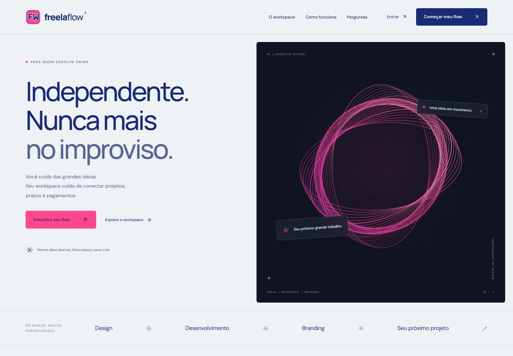
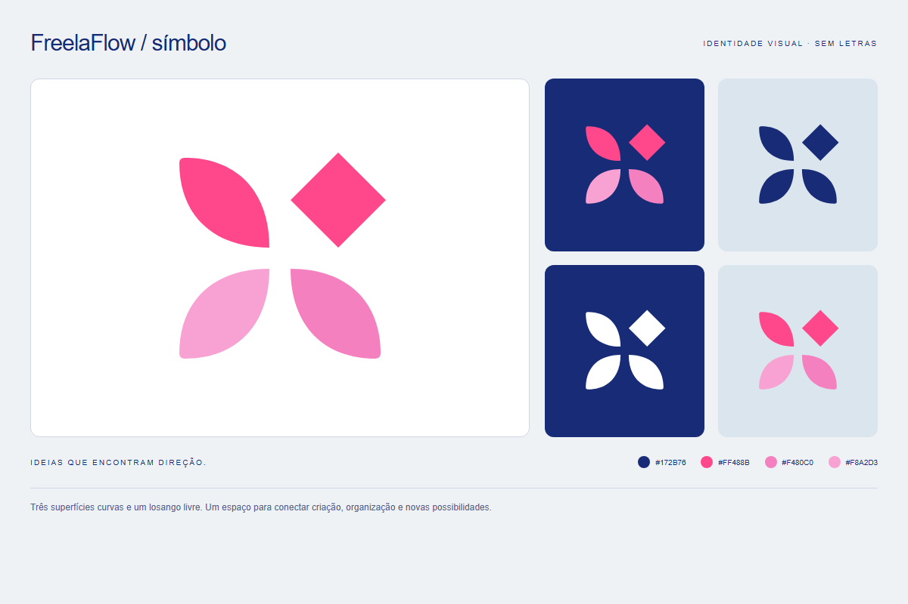

<p align="center">
  
</p>

<h1 align="center">FreelaFlow</h1>

[](https://github.com/PedroMSerpa/freelaflow/actions/workflows/ci.yml)

**Seu trabalho. Seu ritmo. Menos caos, mais flow.**



Um workspace para profissionais independentes organizarem projetos, tarefas, clientes e recebimentos em um único lugar. Criado por [Pedro Serpa](https://github.com/PedroMSerpa) para quem quer dedicar mais tempo ao próprio trabalho e menos tempo a informações espalhadas.

## Mais clareza para trabalhar por conta própria

O freelancer precisa criar e também administrar o próprio trabalho. O FreelaFlow conecta prazos, etapas e valores para reduzir a dispersão entre ferramentas. Um pagamento registrado aparece no resumo; uma tarefa concluída atualiza o progresso do projeto.

Pensado para designers, desenvolvedores, criadores e prestadores de serviços que precisam acompanhar o trabalho do primeiro briefing à entrega.

## Funcionalidades

- Dashboard com indicadores calculados a partir dos projetos.
- Criação, edição e exclusão de projetos, incluindo tarefas, valores e prazos.
- Busca por projeto ou cliente e filtros por status.
- Quadro por etapas com seleção de status e checklist de tarefas.
- Clientes agrupados automaticamente pelos projetos cadastrados.
- Controle manual de recebimentos com atualização dos totais.
- Persistência local dos projetos e tarefas.
- Interface responsiva, navegação por teclado, diálogo nativo e respeito à preferência por movimento reduzido.
- Página de apresentação com arte procedural em SVG, etapas de uso e perguntas frequentes.
- Entrada local pelo nome, sessão por aba e saída do workspace, sem solicitar senha.
- Sidebar com rolagem independente, perfil fixo, recolhimento persistente e menu móvel com navegação por teclado.
- Menu de perfil com nome completo e seleção entre tema claro e escuro, com preferência salva no navegador.

## Começar a usar localmente

Requisitos: Node.js 22 ou superior e npm.

```bash
npm ci
npm run dev
```

Acesse o endereço informado pelo Vite, normalmente `http://127.0.0.1:5173`.

```bash
npm test          # Testes das regras de dados
npm run build    # TypeScript e build de produção
npm run preview  # Servir o build localmente
```

## Tecnologia e estrutura

React 19 · TypeScript · Vite · Lucide · CSS · Vitest

```text
src/
  components/
    LogoMark.tsx               # Símbolo compartilhado da marca
    Sidebar.tsx                # Navegação responsiva e recolhível
    ProjectDialog.tsx          # Formulário de projetos e tarefas
    FlowSculpture.tsx          # Arte procedural em SVG
  lib/projects.ts              # Tipos, validação, dados de demonstração e cálculos
  lib/projects.test.ts         # Testes das regras de dados
  App.tsx                      # Telas, navegação e estado compartilhado
  Experience.tsx               # Apresentação, entrada local e navegação por hash
  experience.css               # Estilos da apresentação, entrada e integração visual
  main.tsx                     # Inicialização do React
  styles.css                   # Identidade visual e responsividade
docs/
  architecture.md              # Decisões e limites da primeira versão
public/brand/                  # Marca, favicon e arquivos para marketing
branding.md                    # Guia de identidade visual
.github/workflows/ci.yml       # Verificação em pushes e pull requests
```

## Design

Identidade própria com azul profundo, cinza azulado e rosa, tipografia Manrope/DM Sans e arte procedural em SVG. A interface combina uma apresentação clara do produto com um painel voltado ao acompanhamento diário do trabalho.

As fontes são carregadas pelo Google Fonts, com fallback para fontes locais. Os ícones são do Lucide, sob licença ISC. A ilustração e o símbolo do aplicativo são feitos em CSS/SVG.

O símbolo da marca é um desenho vetorial original, sem letras: três superfícies curvas e um losango destacado representam um espaço de criação com uma ideia ganhando direção. Usa a paleta rosa do produto, com azul nas aplicações de fundo. O componente `LogoMark` compartilha o mesmo SVG entre apresentação, entrada, painel e sidebar; o favicon aplica o símbolo sobre um fundo azul.

[Ver a identidade visual](docs/screenshots/brand-symbol.png) · [Símbolo SVG](public/brand/freelaflow-symbol.svg) · [Guia e arquivos para marketing](branding.md)



**Arquivos para marketing:** [baixar o kit completo em ZIP](docs/freelaflow-brand-kit.zip), com SVGs, PNGs transparentes em 2048 px, versões monocromáticas, avatar e capa. O favicon também usa a nova marca, em versões SVG e PNG.

## Armazenamento e funcionamento

Os dados iniciais são fictícios. A tela de entrada usa apenas o nome para personalizar a demonstração. A sessão fica em `sessionStorage` (por aba), sem senha, autenticação ou controle de acesso. Os projetos ficam no `localStorage` do navegador atual e são compartilhados entre os nomes usados no dispositivo. Sair encerra a sessão local, mas preserva os projetos. Não existe sincronização entre dispositivos. Limpar os dados do navegador apaga os registros. O controle financeiro registra informações manualmente e não processa pagamentos.

## Próximos passos

- Importação e exportação de backups.
- Autenticação e sincronização com backend.
- Testes de interação e testes ponta a ponta.
- Disponibilização de uma versão pública para uso no navegador.

Veja [as decisões de arquitetura](docs/architecture.md) para conhecer a estrutura e a evolução técnica do produto.

Capturas reais: [página de apresentação](docs/screenshots/landing.png), [entrada local](docs/screenshots/entry.png) e [workspace](docs/screenshots/workspace.png).

[Ver o painel em tema claro e o menu de perfil](docs/screenshots/workspace-light.png).

Para acompanhar o desenvolvimento, consulte os [pull requests](https://github.com/PedroMSerpa/freelaflow/pulls), o [histórico de commits](https://github.com/PedroMSerpa/freelaflow/commits/main) e o [guia de contribuição](CONTRIBUTING.md).

## Autoria

Criado e mantido por [Pedro Serpa](https://github.com/PedroMSerpa).
