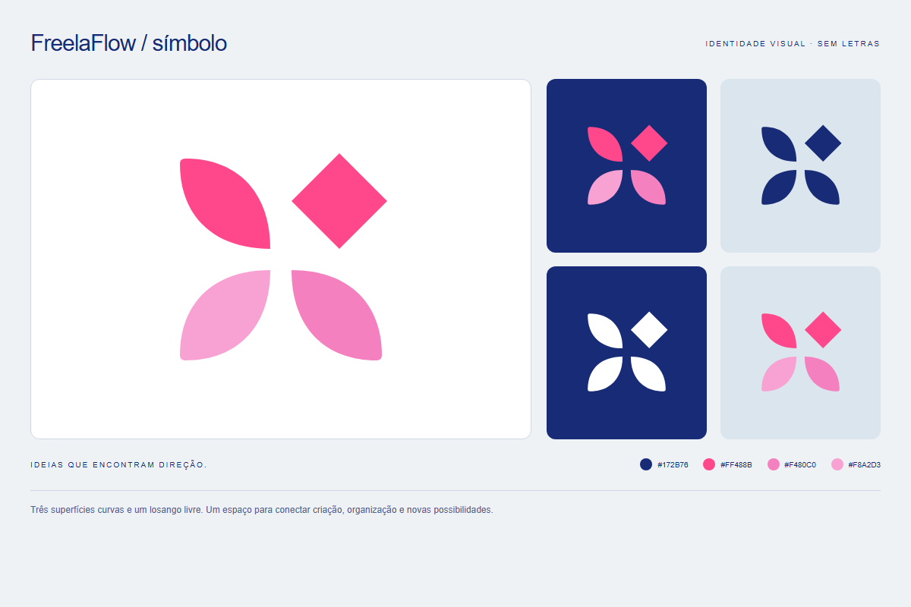

# Identidade visual do FreelaFlow

## Conceito

Marca abstrata sem letras: três superfícies curvas cercam um centro aberto e um losango aponta uma nova possibilidade. A composição conecta o espaço de trabalho à criação e à autonomia do profissional independente. O desenho foi construído em SVG e substitui o antigo monograma FW.

## Arquivos para usar

| Aplicação                                  | Arquivo                                                                                                     |
| ------------------------------------------ | ----------------------------------------------------------------------------------------------------------- |
| Símbolo colorido vetorial e transparente   | [SVG](public/brand/freelaflow-symbol.svg)                                                                   |
| Símbolo colorido transparente, 2048 × 2048 | [PNG](public/brand/freelaflow-symbol-2048.png)                                                              |
| Versão azul monocromática                  | [SVG](public/brand/freelaflow-symbol-mono.svg) · [PNG 2048](public/brand/freelaflow-symbol-navy-2048.png)   |
| Versão branca para fundos escuros          | [SVG](public/brand/freelaflow-symbol-white.svg) · [PNG 2048](public/brand/freelaflow-symbol-white-2048.png) |
| Avatar com fundo azul, 1080 × 1080         | [PNG](public/brand/freelaflow-avatar-1080.png)                                                              |
| Capa com fundo azul, 1200 × 630            | [PNG](public/brand/freelaflow-cover-1200x630.png)                                                           |
| Favicon com fundo azul                     | [SVG](public/brand/favicon.svg) · [PNG 32](public/brand/favicon-32.png)                                     |
| Ícone para dispositivos Apple, 180 × 180   | [PNG](public/brand/apple-touch-icon.png)                                                                    |

O [kit ZIP](docs/freelaflow-brand-kit.zip) reúne os arquivos de marca para download.

## Paleta

| Cor                | Código    |
| ------------------ | --------- |
| Azul profundo      | `#172B76` |
| Rosa principal     | `#FF488B` |
| Rosa intermediário | `#F480C0` |
| Rosa claro         | `#F8A2D3` |
| Fundo claro        | `#EEF2F5` |

## Aplicação

- Prefira SVG em sites e materiais que precisem de escala sem perda de qualidade.
- Use os PNGs transparentes em apresentações, peças de divulgação e editores de imagem.
- Mantenha a proporção quadrada e espaço livre ao redor; não estique nem corte os elementos.
- Em fundos com imagens, use uma área lisa ou a versão branca com contraste suficiente.
- Em tamanhos muito pequenos, use a composição do favicon sobre fundo azul.

Os PNGs foram exportados dos mesmos SVGs usados no aplicativo. Para alterar o desenho, atualize as variantes vetoriais e reexporte as aplicações para manter a identidade consistente.
